# Схема CC с Binance KZ в роли кастодиана

Дата: 06.10.2026. Разбор схемы «Commodity Chain Ltd + лицензированный кастодиан + платёжная система» (слайды команды CC от 05.10.2026) для случая, когда кастодиан — Binance Kazakhstan. Учитываются два варианта эмитента: фермер или F2F Proto. Конечные деньги должны дойти до фермера в тенге.

Это оценка по правилам МФЦА и материалам [исследования](research-aifc-f2f-ru.md) и [сценариев](scenarios-aifc-f2f-ru.md), а не юридическое заключение. Пометки: [V] проверено по первоисточнику, [I] вывод, [?] нужно подтвердить.

## 1. Главный вывод

1. **Binance KZ может хранить деньги, но не наш токен.** Лицензия BN KZ Technologies Limited (AFSA-A-LA-2024-0028) покрывает цифровые активы: Custody, DATF, Money Services, Principal, Agent; из Investments только Future и Option [V]. Investment Token по определению исключён из Digital Asset [V]. Поэтому WHEAT-2077 нельзя ни держать на Binance KZ, ни торговать там.
2. **Схема распадается на две ноги.** Денежная нога (USDT или USDC и тенге) — Binance KZ. Токенная нога — кто-то другой: кастодиан с разрешением на Investments, реестр эмитента с собственными кошельками инвесторов или сама CC, если получит Providing Custody [I].
3. **«Всё или ничего» между двумя организациями не получается обычной проводкой.** Деньги у Binance KZ, токен у другого хранителя: одна сторона может пройти без другой. Решение, которое у нас уже есть: расчёт на блокчейне. Стейблкоин выводится с Binance KZ в блокчейн и обменивается на токен атомарно нашей программой на Solana (подписка = USDC в хранилище пула и выпуск токена в одной транзакции) [I].
4. **Binance KZ не исполняет поручения третьей стороны между своими клиентами.** На схеме CC «направляет поручения кастодиану» перевести деньги с суб-счёта инвестора на суб-счёт эмитента. У биржи цифровых активов каждый клиент управляет своим счётом сам; переводы между клиентами по указанию CC — это отдельный продукт, если он вообще есть [?]. Это главный вопрос к Binance KZ.

## 2. Потоки денег с Binance KZ

```mermaid
flowchart LR
  I[Инвестор] -- тенге или доллары --> BKI[Счёт инвестора в Binance KZ]
  BKI -- покупка USDT/USDC --> BKI
  BKI -- вывод стейблкоина на свой кошелёк --> W[Кошелёк инвестора на Solana]
  W -- подписка: USDC в пул, токен инвестору --> P[Программа F2F на Solana]
  P -- выплата при закрытии сбора --> E[Эмитент: кошелёк]
  E -- стейблкоин на корпоративный счёт --> BKE[Счёт эмитента в Binance KZ]
  BKE -- продажа за тенге, вывод на свой счёт --> BANK[Счёт эмитента в банке РК]
  BANK -- если эмитент F2F Proto: заём или аванс в тенге --> F[Фермер]
```

Погашение — зеркально: фермер платит тенге, тенге меняется на стейблкоин на Binance KZ, стейблкоин вносится в пул, инвесторы гасят токены.

Ограничения, которые влияют на схему:
- вывод фиата у DATF — только на собственные счета клиента [V];
- фиатные каналы Binance KZ: Freedom Bank (ввод и вывод), Казпочта (ввод), около 420 000 тенге за операцию для физлиц [?]; для корпоративных клиентов лимиты нужно узнать [?];
- USDT, USDC, SOL и TRX в списке разрешённых Нацбанком РК необеспеченных цифровых активов (28.04.2026) [V];
- площадка DATF держит отдельные кошельки на каждого клиента и сверяется ежедневно [V].

## 3. Эмитент — фермер

**Как идут деньги.** Выплата из пула идёт прямо на кошелёк фермера. Фермер, юрлицо РК, сам открывает корпоративный счёт на Binance KZ, продаёт стейблкоин и выводит тенге на свой счёт в банке РК. При погашении покупает стейблкоин за тенге и вносит в пул.

**Плюсы.** Нет посредника на балансе; F2F Proto не кредитует и не рискует своим капиталом; прямое соответствие терм-шиту, где фермер — эмитент.

**Нюансы.**
1. **Фермер касается крипты.** Нужен корпоративный счёт на Binance KZ, KYB, кто подписывает транзакции, учёт криптоактивов в бухгалтерии РК [?]. Для большинства хозяйств это барьер.
2. **Обязанности эмитента.** Освобождённая оферта по MAR 1.1.2 или проспект, раскрытие информации, ответственность за документы предложения [V]. Фермер — не участник МФЦА; можно ли нерезиденту МФЦА выпускать Investment Token через биржу МФЦА и на каких условиях [?].
3. **Налог у источника.** Купон, который фермер, резидент РК, платит иностранным инвесторам, может облагаться налогом у источника выплаты в РК [?]. Льготы МФЦА на фермера не распространяются [I].
4. **Валютный риск на фермере.** Обязательство в долларах, выручка в тенге [I].
5. **Валютный контроль.** Получение и возврат в долларовом эквиваленте от нерезидентов, регистрация или уведомление по крупным суммам [?].
6. **Поставка зерна.** Право на зерно и складская расписка Qoldau — инструмент РК; кто держит расписку и как она переходит инвестору [?].

## 4. Эмитент — F2F Proto

**Как идут деньги.** Выплата из пула идёт на кошелёк F2F Proto. F2F Proto, участник МФЦА, продаёт стейблкоин на Binance KZ со своего корпоративного счёта, выводит тенге на свой счёт в банке РК и передаёт фермеру по договору: тенговый заём или аванс (форвардная закупка зерна). При погашении фермер возвращает тенге или зерно F2F Proto, F2F Proto меняет тенге на стейблкоин и вносит в пул.

**Плюсы.** Фермер не касается крипты и получает тенге обычным переводом; инвесторы видят одного эмитента МФЦА; можно объединять несколько фермеров в один пул; возможны льготы МФЦА по налогам [?].

**Нюансы.**
1. **Кредитование.** Заём фермеру — Providing Credit в МФЦА (GEN Sch.1 п.18) [V] и, возможно, лицензируемая деятельность в РК [?]. Аванс за зерно (форвард) может не считаться кредитом, и он ближе к гибриду «поставка с правом выкупа» [I].
2. **Риск на балансе F2F Proto.** Если фермер не вернёт, обязательство перед инвесторами остаётся у F2F Proto. Нужна изоляция по пулам: отдельная SPV или защищённая ячейка на каждый выпуск [I].
3. **Обязанности эмитента** переходят на F2F Proto: оферта, раскрытие, управление залогом, контроль поставки [V].
4. **Валютный риск.** Кто несёт разницу тенге и доллара: фермер (заём в долларовом эквиваленте) или F2F Proto (заём в тенге) [?].
5. **Налоги** на проценты от фермера и выплаты инвесторам, применимость льгот МФЦА [?].
6. **Роль CC.** Если F2F Proto эмитент, а CC — биржа, F2F Proto ещё и сам привлекает инвесторов? Тогда нужна лицензия на Arranging Deals или одобрение рекламы лицензированной фирмой [I].

## 5. Сравнение вариантов эмитента

| Критерий | Фермер — эмитент | F2F Proto — эмитент |
| --- | --- | --- |
| Фермер касается крипты | да, счёт на Binance KZ | нет, получает тенге |
| Лицензия на кредитование | не нужна | Providing Credit или форвард вместо займа [?] |
| Риск невозврата | у инвесторов напрямую | у F2F Proto, нужна SPV на пул |
| Налог у источника на купон | вероятен в РК [?] | зависит от льгот МФЦА [?] |
| Обязанности эмитента | на фермере | на F2F Proto |
| Объединение фермеров в пул | нет, один фермер — один выпуск | да |
| Соответствие пилотному терм-шиту | прямое | нужно переписать терм-шит |

## 6. Открытые вопросы

**Binance KZ**
1. Может ли Binance KZ исполнять поручения CC между счетами разных клиентов (инвестор → эмитент), или каждый перевод делает сам клиент?
2. Есть ли корпоративные счета для юрлиц РК (фермер) и для участников МФЦА (F2F Proto, CC), и какие лимиты вывода тенге?
3. Есть ли мастер- и суб-счета для институционалов и API для платформы-партнёра?
4. Какие стейблкоины и сети поддерживаются для вывода: USDC на Solana, USDT на TRON?
5. Разрешает ли Binance KZ вывод на кошельки, которые контролирует программа (хранилище пула), или только на кошельки клиента?
6. Планирует ли Binance KZ расширить лицензию на Investments (Providing Custody of Investments), чтобы хранить и токен?

**AFSA и консультант**
7. Кто может хранить WHEAT-2077 как Investment Token: кастодиан МФЦА с разрешением на Investments, реестр эмитента с собственными кошельками инвесторов, или CC после получения Providing Custody?
8. Покрывает ли лицензия CC (Exchange и Clearing House) расчёт, где денежная нога — стейблкоин, выведенный с DATF, а поставка против оплаты идёт программой на блокчейне?
9. Может ли эмитентом Investment Token на бирже МФЦА быть юрлицо РК, не участник МФЦА?
10. Тенговый заём фермеру от участника МФЦА: нужен ли Providing Credit, лицензия РК, или подходит форвардный аванс?
11. Налог у источника на купон в обоих вариантах, льготы МФЦА.
12. Валютный контроль РК: получение долларового эквивалента и возврат.

**Внутренние решения**
13. Кто эмитент: фермер (как в пилотном терм-шите) или F2F Proto?
14. Кто несёт валютный риск: фермер или F2F Proto?
15. Где хранится токен по умолчанию, если не на Binance KZ: собственный кошелёк инвестора (сейчас так в MVP) или кастодиан с разрешением на Investments?

## 7. Что это значит для платформы

- **Ничего не ломается.** MVP уже работает так, как требует эта схема: стейблкоин на кошельке инвестора, атомарный обмен на токен программой, токен у инвестора на кошельке с KYC на уровне платформы.
- **Добавить:** путь «пополнить через Binance KZ» в кабинете инвестора (инструкция и проверка поступления USDC), путь «вывести в тенге» в кабинете эмитента (для F2F Proto — тенговая выплата фермеру как событие журнала с номером платёжного поручения).
- **Если эмитент F2F Proto:** в программе эмитентом пула становится кошелёк F2F Proto (сейчас — фермер, ADR 0014), а фермер — получатель тенге вне блокчейна; договор с фермером и платёжка — документы в бакете с хешем в журнале.

## 8. Несколько ТОО-фермеров, у каждого свой токен

Схема в Excalidraw (06.10.2026): F2F Proto организует выпуски, каждое ТОО — эмитент своего токена под свои поля (WHEAT27-A, WHEAT27-B, …).

- **Эмитенту брокерская лицензия не нужна.** Выпуск собственных инструментов не лицензируется [I]. Эмитенту нужны проспект или освобождённая оферта по MAR 1.1.2 и допуск к листингу на бирже CC [V].
- **Лицензия нужна тому, кто собирает инвесторов под чужие выпуски.** Если F2F Proto делает это «от имени» ТОО — это Arranging Deals in Investments, а если принимает деньги инвесторов — ещё Dealing as Agent [V]. Альтернатива: F2F Proto — технический подрядчик CC по GEN 5.2, а размещение ведёт CC или брокер [I].
- **Эмитент в реестре — каждое ТОО.** F2F подписывает операции в программе по договору с ТОО; деньги идут на счёт ТОО, мимо баланса F2F. В программе это уже так: `Pool.issuer` — кошелёк эмитента (ADR 0014).
- **Отдельный токен, пул и хранилище USDC на каждое ТОО:** дефолт одного не задевает инвесторов других. Общий пул нескольких ТОО с общей доходностью несёт риск признания фондом (FSFR s.92) [I].
- **Каждому ТОО нужны:** KYB, своя оферта, корпоративный счёт на Binance KZ для вывода тенге. Открыт вопрос о налоге у источника на купон [?].

## 9. Кто хранит токены WHEAT

Не Binance KZ. Нужен кастодиан с Providing Custody на Investments, не только на цифровые активы [V]. Кандидаты из реестра AFSA ([сценарии](scenarios-aifc-f2f-ru.md)):

| Фирма | Лицензия | Что важно |
| --- | --- | --- |
| Freedom Finance Global PLC | AFSA-A-LA-2020-0019 | Debentures, Dealing, Providing Custody; плюс custody цифровых активов — может держать и деньги, и токен |
| ASPAN Capital Ltd. | AFSA-A-LA-2025-0029 | Debentures, Dealing, Providing Custody |
| Abylai Global Solutions | AFSA-A-LA-2023-0001 | Dealing, Providing Custody, член AIX |
| Turanga Capital Ltd. | AFSA-A-LA-2025-0010 | Providing Custody, только профессиональные клиенты |
| AIX CSD, ITS CSD | депозитарии | классический учёт ценных бумаг; токены на Solana — вопрос [?] |
| SkyBridge Digital Finance | AFSA-G-LA-2023-0006, FinTech Lab | единственная запись с явным «Security Tokens», но без Providing Custody — брокер, не хранитель |

Вопросы кандидату: умеет ли он держать токены на Solana (ключи, Token-2022 с заморозкой), может ли выступать хранителем на имя каждого инвестора, работает ли с поручениями клиринга CC. Самохранение на кошельке инвестора с KYC платформы остаётся запасным вариантом [?].
