# Кабинеты F2F: как устроены входы, онбординг и бэк-офис у RWA- и краудлендинговых платформ

Исследование для редизайна кабинетов Field-to-Finance (фаза 1). Дата доступа ко всем источникам и скриншотам: 07.10.2026.

## 1. Краткий вывод

1. Ни одна из изученных платформ не спрашивает после входа «кто вы: инвестор или заёмщик». Аудитория разводится **до регистрации**: отдельные пункты меню и CTA на лендинге (AcreTrader: Invest / For Farmers [16]; Superstate: Issuers / Investors [36]; Harvest Returns: Invest Now / Ag Business: Raise Capital [20]; iKapitalist: две кнопки «Привлечь инвестиции» и «Стать инвестором» [10]).
2. Главная CTA лендинга почти всегда инвесторская («Create account», «Start investing», «Get Started» [1][5][16]). Путь заёмщика начинается со страницы-объяснения с требованиями и кнопкой «Apply for funding» [20][17], а не с личного кабинета.
3. Онбординг инвестора разбит на явные этапы: аккаунт, KYC, категоризация или проверка квалификации, затем кошелёк или реквизиты для выплат [35][37][34]. В ЕС для непрофессионалов обязательны тест знаний, симуляция потерь и KIIS по каждому предложению [9]; Mintos по MiFID II открывает способы инвестирования по результату теста [2].
4. Кошелёк у RWA-платформ вторичен по отношению к личности: Tokeny привязывает владение к ONCHAINID и предлагает встроенный кошелёк на passkey [25]; Superstate и Ondo запрашивают адреса кошельков **после** одобрения KYC [37][35].
5. Портфель у краудлендинга строится вокруг трёх чисел (стоимость, доход, свободные деньги) и выписки с фильтрами [4][6][8]; страница сделки у всех имеет вкладки (Overview / Financials / Documents / Repayment / Risk) и блок документов [18][33].
6. Служебные роли у RWA-инфраструктуры решены как **одна консоль эмитента с назначаемыми агентами и правами**, а не отдельные кабинеты: у Tokeny это Servicing App с ролями Admin / Token Creator / Token Owner / Token Agent и правом Compliance Officer [27][29][26]. Общие SaaS-образцы (Stripe, Linear, Retool) дают готовую модель: роли как наборы прав, приглашения, аудит-лог, двухсторонние подтверждения [38][40][42][43][44].
7. Для F2F это подтверждает решения от 07.10.2026: убрать выбор роли после входа, развести двери на лендинге, заменить пять кабинетов одной консолью `/console` с правами. Дополнительно стоит: (а) не давать arranger по умолчанию права решать KYC и подписывать аттестации партнёров (разделение обязанностей); (б) переносить привязку кошелька на момент после одобрения KYC; (в) показывать риск-предупреждение и лицензию на каждой публичной странице пула.

## 2. Методика и ограничения

- Изучены только публичные страницы: лендинги, how-it-works, справочные центры, документация, публичные страницы приложений, которые открываются без входа. Регистраций и входов не было.
- Скриншоты сделаны headless Chromium (desktop 1440 px, mobile 390 px), cookie-баннеры закрыты. Под каждым скриншотом URL и дата доступа.
- Кабинеты инвесторов Mintos, Bondora, FarmTogether, AcreTrader и бэк-офисы Securitize, Mintos, Bondora закрыты логином. Где публичных данных нет, это сказано прямо; выводы о закрытых экранах помечены словом **Вывод**.
- Факты помечены номером источника в квадратных скобках, полный список в разделе 7. Всё с пометкой «Вывод» или «Для F2F» является интерпретацией автора отчёта.
- Поиск: 36 запросов к Brave Search API, плюс прямые загрузки страниц.

## 3. Разбор по бенчмаркам

### 3.1 RWA-токенизация

#### Securitize

- **Кому:** инвесторы в токенизированные фонды (BUIDL и др.) и эмитенты.
- **Вход:** на лендинге «Sign Up» и «Log In» в шапке, баннер-ссылка «Start investing» на конкретный фонд [22].
- **Онбординг:** справочный центр эмитентов описывает KYC-сервис Securitize как продукт, который эмитент встраивает к себе, и проверку статуса верификации инвестора через API [23]. В разделе «Investors» есть статьи о настройке аккаунта, верификации личности и проверке статуса [24].
- **Бэк-офис:** у эмитентов есть Control Panel (`cp.securitize.io`). В справке эмитентов есть статья «Log in as an investor via API» [24]. **Вывод:** это вариант «входа от лица инвестора» для эмитента; публичных деталей о ролях Control Panel найти не удалось.
- **Для F2F:** KYC как статус учётной записи, который читают и инвесторский кабинет, и консоль; отдельный поток для эмитента.

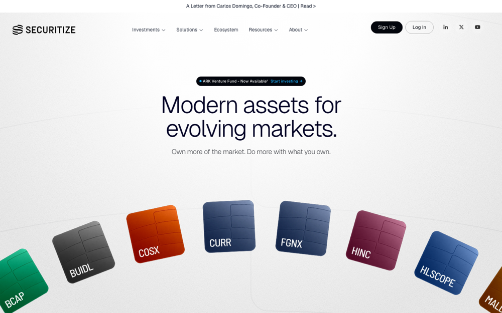
*Источник: https://securitize.io/ , доступ 07.10.2026*

#### Tokeny (T-REX / ERC-3643, ONCHAINID)

Самый близкий к F2F образец бэк-офиса.

- **Кому:** эмитенты и назначенные ими агенты (Servicing App), инвесторы (Investor App) [27].
- **Онбординг инвестора:** эмитент в Servicing App настраивает, какие данные и документы собирать [25]. Владение токеном привязано к ONCHAINID, кошелёк используется только для подписи; для новичков есть встроенный кошелёк на passkey (FaceID/TouchID) [25].
- **Квалификация:** все прошедшие онбординг попадают в Candidate List; эмитент или назначенный Compliance Officer нажимает «Qualify», что подписывает ончейн-операцию и выдаёт claim в ONCHAINID; квалификацию можно отозвать, после чего инвестор теряет право держать токен во всей экосистеме [26].
- **Роли:** четыре роли платформы с матрицей доступа: Admin (настройки платформы, остальное только чтение), Token Creator (создание и деплой токена), Token Owner (настройки токена, назначение агентов, квалификация, рынки), Token Agent (действия с токеном) [29]. Агентов назначают для повседневных операций, чаще всего это KYC-агенты и надзор за переводами [27]. Права агентов делятся по доменам на Read/Write: Identities, Assets, Distribution [28].
- **Для F2F:** прямое обоснование модели «консоль + узкие права»: отдельное право на квалификацию и отзыв (kyc.decide / kyc.revoke), внешние агенты без доступа к настройкам.

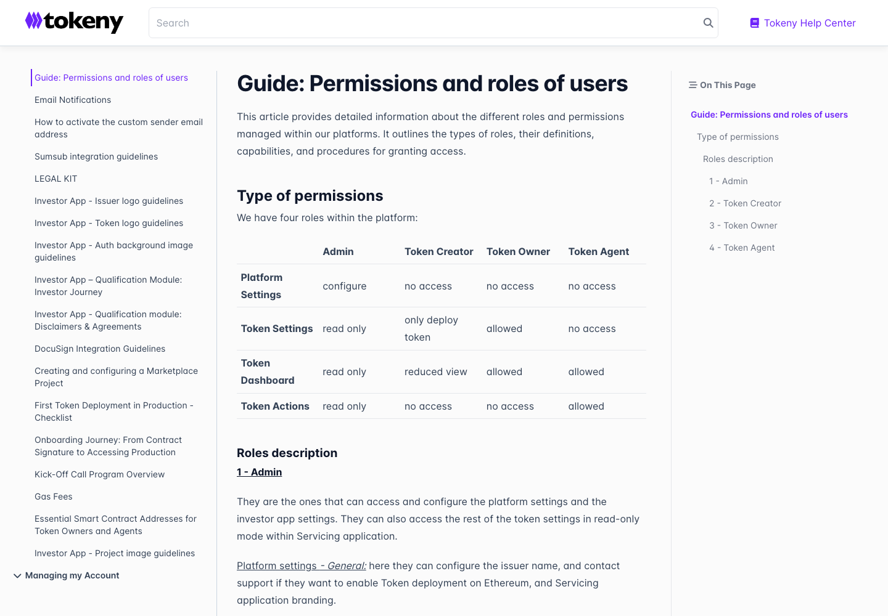
*Источник: https://d9awyx7m9zmryg2.productfruits.help/en/article/guide-permissions-and-roles-of-users (Tokeny Help Center), доступ 07.10.2026*

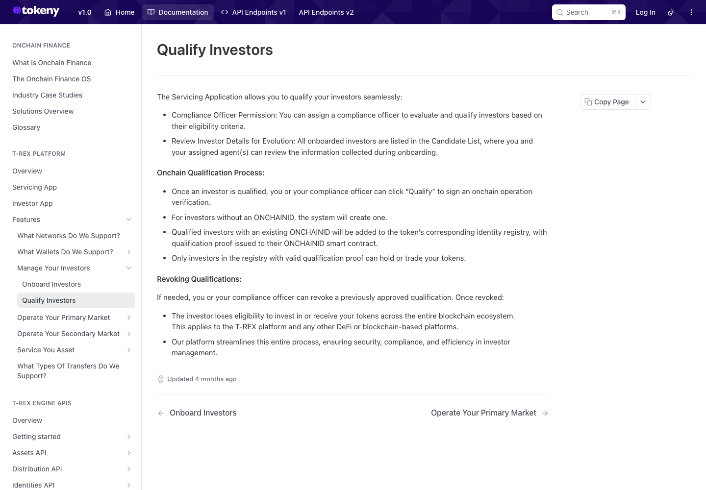
*Источник: https://docs.tokeny.com/docs/qualify-investors , доступ 07.10.2026*

#### Centrifuge

- **Кому:** институциональные инвесторы в токенизированные фонды и DeFi-пользователи.
- **Вход:** публичная витрина `app.centrifuge.io` без регистрации, единственная кнопка в шапке «Connect wallet» [30].
- **Витрина:** карточки фондов с AUM, APY, типом актива, минимальной суммой (500K USD для прямого доступа, 10K USD для deRWA-токенов) и меткой «Investors only» у закрытых фондов; разделы «Direct fund access» и «DeFi-native tokens» [30].
- Документация по онбордингу инвесторов существует (Investor Onboarding Guide), но страница рендерится только в браузере, детали шагов проверить не удалось.
- **Для F2F:** публичная витрина пулов с ключевыми цифрами и меткой доступа до любой регистрации.

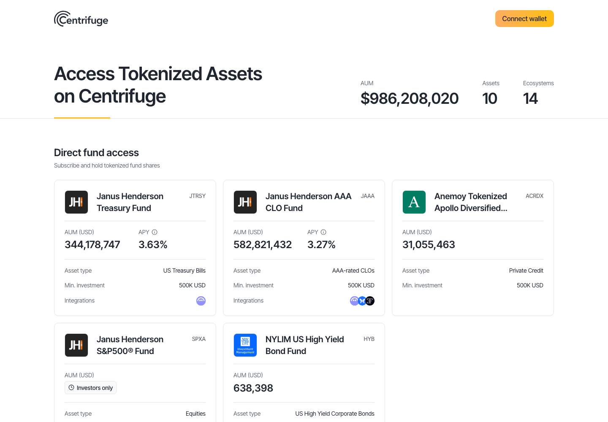
*Источник: https://app.centrifuge.io/ , доступ 07.10.2026*

#### Maple

- **Кому:** институциональные кредиторы (Maple Institutional), розничные держатели syrupUSDC/USDT, заёмщики [32].
- **Вход:** `app.maple.finance` открывается формой «Create your Maple account» (Google или email), справа ценностные тезисы; отдельная ссылка «Looking for Maple Open Access? Go to Maple Earn» [31].
- **Документация** разведена по аудиториям: разделы для кредиторов, для заёмщиков (Borrower Guide, Account Management, Loan Management), отдельные Risk Disclosures [32].
- **Для F2F:** вход по email без выбора роли; продукт для другой аудитории уводится отдельной ссылкой, а не переключателем внутри.

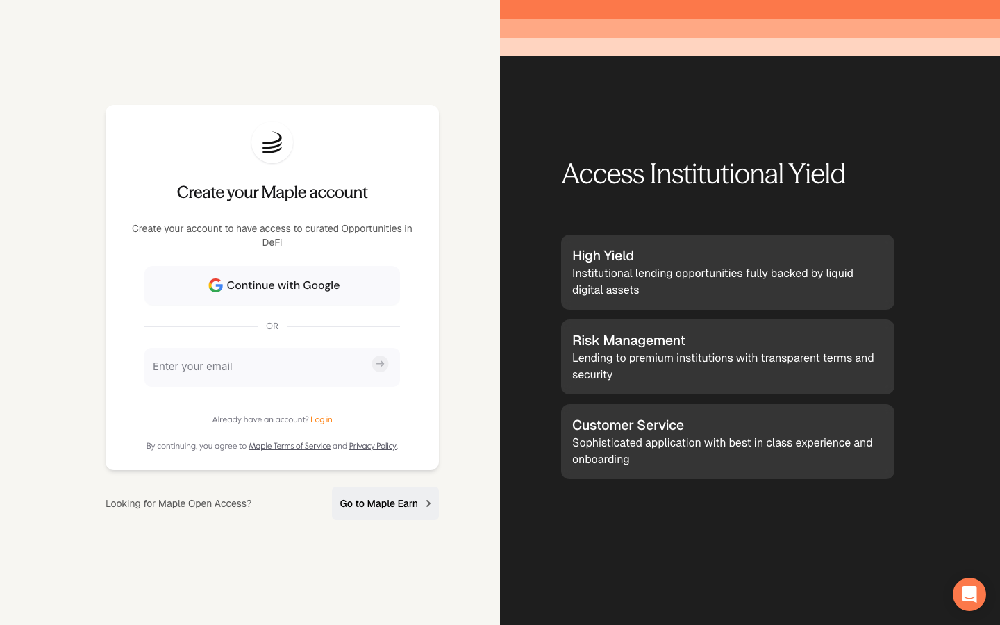
*Источник: https://app.maple.finance/ , доступ 07.10.2026*

#### Goldfinch

- **KYC через UID:** пользователь сам указывает: физлицо или компания, США или нет, для США аккредитован или нет. Дальше ветвление: не-США физлица идут в Persona (документ и селфи), компании и аккредитованные инвесторы США в Parallel Markets; о результате приходит email, после чего UID минтится на странице аккаунта [34].
- **Страница пула:** баннер допуска «This offering is only available to non-U.S. persons or U.S. accredited investors», красный баннер о дефолте пула, вкладки Overview / Highlights / Repayment / Portfolio / Risk, честное сообщение об ошибке загрузки данных [33].
- **Для F2F:** ветвление KYC по типу инвестора в одной анкете; баннер допуска на странице пула; вкладка Repayment.

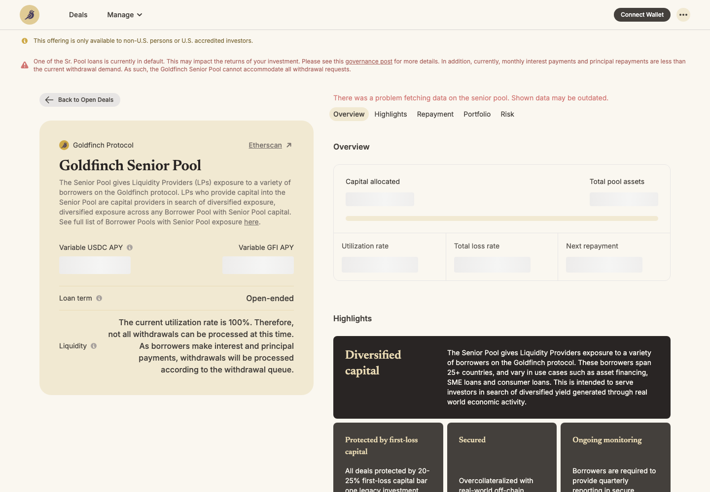
*Источник: https://app.goldfinch.finance/pools/senior , доступ 07.10.2026*

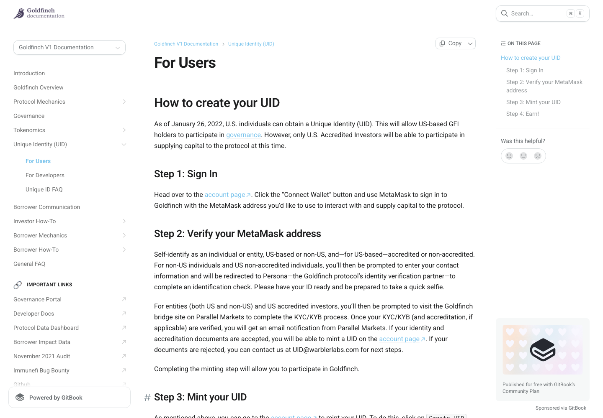
*Источник: https://docs.goldfinch.finance/goldfinch/goldfinch-v1/unique-identity-uid/for-users , доступ 07.10.2026*

#### Ondo

- Онбординг в квалифицированные фонды в три шага: KYC (для компаний: регистрационные документы, директора, бенефициары; для физлиц: адрес, документ, налоговый номер; доказательство аккредитации), реквизиты (адреса кошельков для токенов фонда), подписание документов. Данные проверяются по санкционным спискам и вручную командами онбординга и комплаенса [35].
- **Для F2F:** кошелёк запрашивается после одобрения KYC; ручная проверка комплаенсом как отдельный этап.

#### Superstate

- **Вход:** в шапке «Issuers» и «Investors», «Sign in» и «Register» [36].
- **Онбординг:** регистрация (email, название организации, подтверждение почты, пароль, рекомендованная 2FA), затем анкета (Applications), проверка (Application Review), затем настройка: Allowlist (адреса кошельков, которым разрешено держать токены) и Payout Destination [37]. Допуск зависит от продукта: токенизированные акции доступны всем в поддерживаемых странах, фонды только Qualified Purchasers [37].
- **Для F2F:** этапы с явным статусом проверки; кошелёк и адрес выплат как настройки после одобрения.

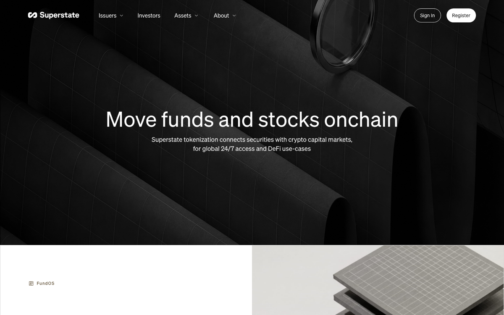
*Источник: https://superstate.com/ , доступ 07.10.2026*

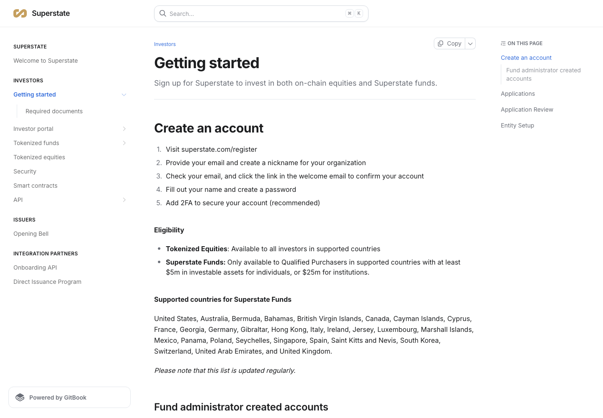
*Источник: https://docs.superstate.com/welcome-to-superstate/onboarding , доступ 07.10.2026*

#### Figure, Libre, Backed, Archax, платформы на Polymesh

Публичных материалов об устройстве кабинетов и бэк-офиса у этих платформ найти не удалось: лендинги ориентированы на институциональных клиентов и ведут на «Contact us» или во внешние приложения. Как источники паттернов они в отчёт не включены.

### 3.2 Краудлендинг и агрофинансирование

#### Mintos (Латвия, инвестиционная фирма по MiFID)

- **Вход:** одна главная CTA «Create account» и «Log in» в шапке; под героем три сигнала доверия: 700K+ пользователей, €800m+ под управлением, «Licensed investment firm under MiFID» [1].
- **Suitability & Appropriateness:** обязательна до инвестирования, пять блоков вопросов (финансовое положение, знания, опыт, цели, устойчивость). Результат определяет, какие способы инвестирования доступны; ручные инвестиции доступны всегда, но с предупреждением; для автоматических портфелей может действовать индивидуальный лимит суммы [2].
- **Риск:** Mintos Risk Score из четырёх подоценок (качество портфеля кредитора, обслуживание, сила buyback, юридическая схема); оценка может быть отозвана со статусом «Score Withdrawn» [3].
- **Портфель и выписки:** все транзакции в разделе Account Statement с фильтрами, там же считается полученный доход [4].
- **Раскрытия:** в подвале юрлицо, регулятор (Latvijas Banka), схема компенсации инвесторов до €20 000 и стандартное риск-предупреждение со ссылкой на risk information [1].

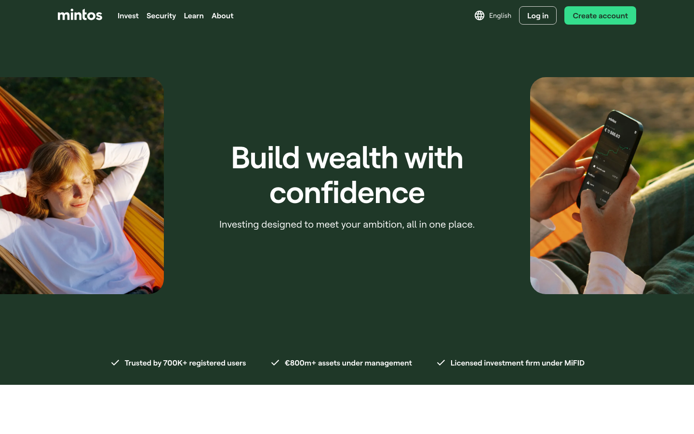
*Источник: https://www.mintos.com/en/ , доступ 07.10.2026*

*Источник: https://www.mintos.com/en/ (390 px), доступ 07.10.2026*

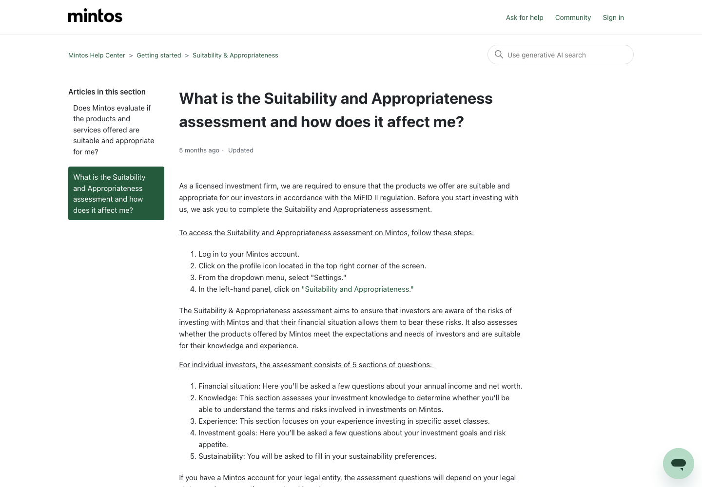
*Источник: https://help.mintos.com/hc/en-us/articles/6173936149649 , доступ 07.10.2026*

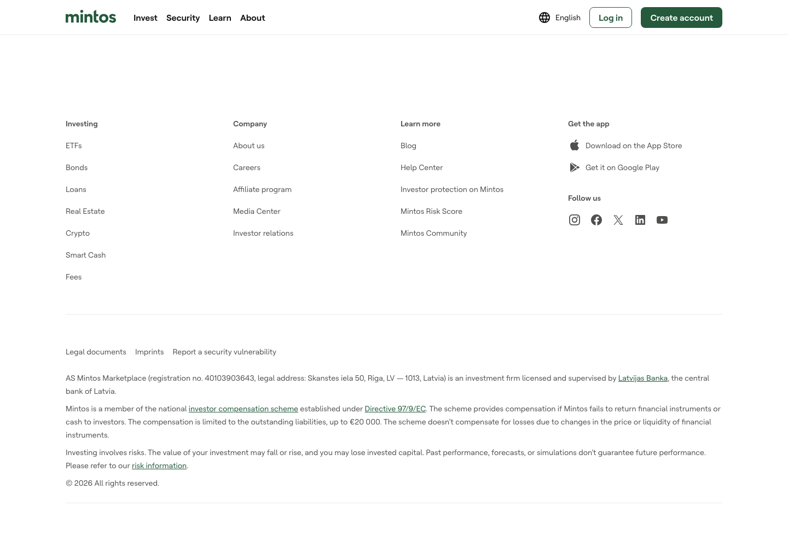
*Источник: https://www.mintos.com/en/ (подвал), доступ 07.10.2026*

#### Bondora / Go & Grow

- **Вход:** одна CTA «Start investing», калькулятор будущего дохода с подписью «illustrative estimate... Investments are subject to risk», ссылка на отзывы Trustpilot [5].
- **Значения счёта:** «Added» (внесено минус выведенный капитал) и «Gained» (текущая стоимость минус внесённое минус комиссии); выписка Go & Grow с движением денег [6].
- **Риск-заявление:** отдельная страница: нет гарантий, нет государственной защиты, долгосрочность, возможность убытка, налоги на стороне инвестора [7].

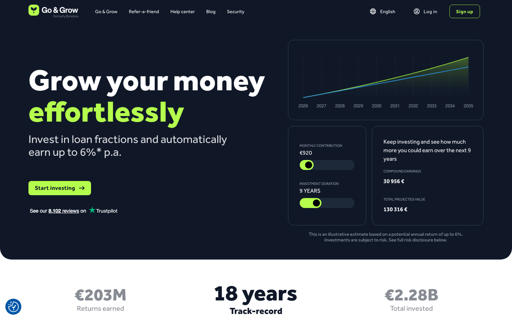
*Источник: https://goandgrow.eu/en/ , доступ 07.10.2026*

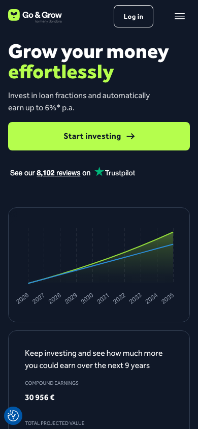
*Источник: https://goandgrow.eu/en/ (390 px), доступ 07.10.2026*

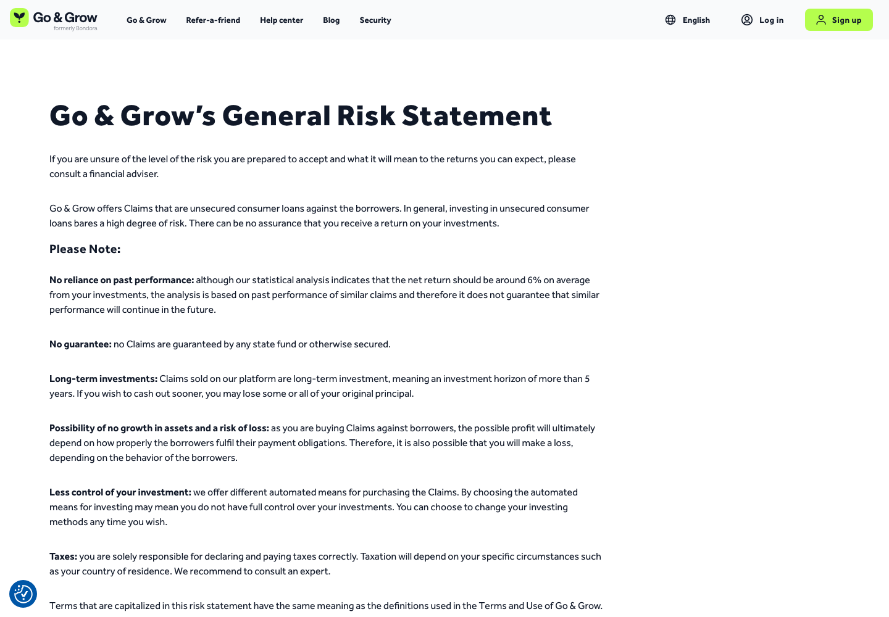
*Источник: https://goandgrow.eu/en/riskstatement/ , доступ 07.10.2026*

#### PeerBerry, Esketit (контекст ECSPR)

- PeerBerry на лендинге показывает макет экрана Overview: «Profit status», график, «Available for investment», кнопка «Add funds» [8]. Это редкий публичный пример инвесторского дашборда.
- По регламенту ЕС о краудфандинге (ECSPR) платформа обязана: оценивать знания и опыт непрофессиональных инвесторов (пересмотр раз в два года), требовать ежегодную симуляцию способности нести убыток в 10% чистых активов, давать 4 дня на отказ от инвестиции и публиковать KIIS по каждому предложению [9]. **Вывод:** для F2F аналог KIIS это Key Features Document, который в базовой IA уже стоит перед панелью инвестирования.

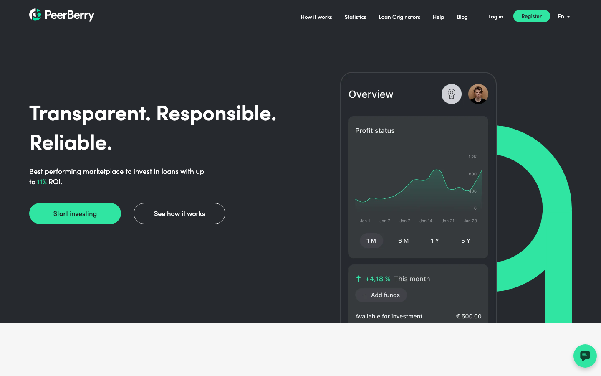
*Источник: https://peerberry.com/en , доступ 07.10.2026*

#### iKapitalist (Казахстан, МФЦА)

Ближайший регуляторный аналог для F2F.

- **Вход:** две равноправные кнопки «Привлечь инвестиции» и «Стать инвестором», обе ведут на `platform.ikapitalist.kz`; рядом номер лицензии AFSA со ссылкой на публичный реестр [10].
- **Единая страница входа:** форма с вкладками «Вход» и «Регистрация» [12]. **Вывод:** роль определяется дальнейшим сценарием, а не выбором после входа.
- **Страница для инвесторов:** порог входа («Вы можете начать с 300.000 тенге»), постоянный баннер «Рисковый капитал: Ваш фактический доход может быть ниже ожидаемого. Не покрывается системой гарантирования депозитов в Казахстане», проверка компаний по 60+ показателям, подписание соглашений ЭЦП [11].
- **Карточки сделок:** тип (заём), отрасль, цель, ставка, срок, процент сбора, статус «На исполнении» [10].
- **Для F2F:** формулировка риск-баннера и ссылка на реестр AFSA как сигнал доверия; одна страница входа.

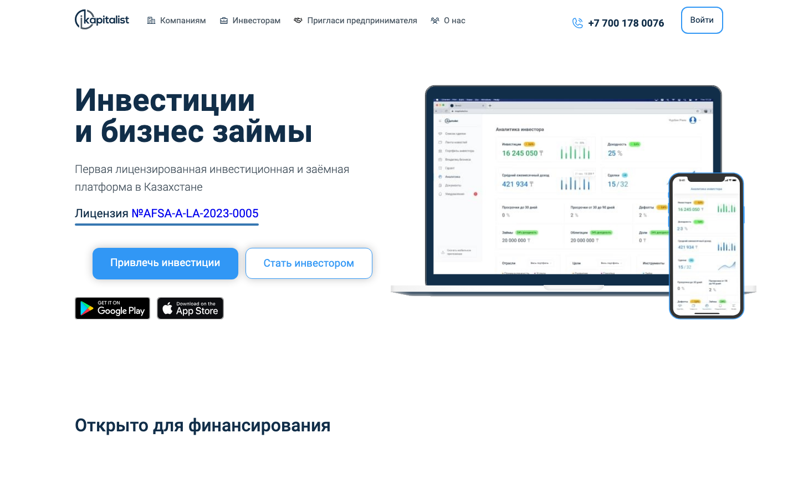
*Источник: https://ikapitalist.kz/ , доступ 07.10.2026*

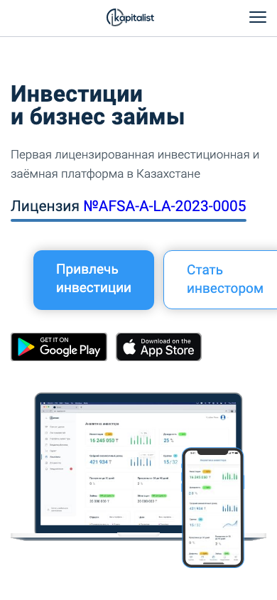
*Источник: https://ikapitalist.kz/ (390 px), доступ 07.10.2026*

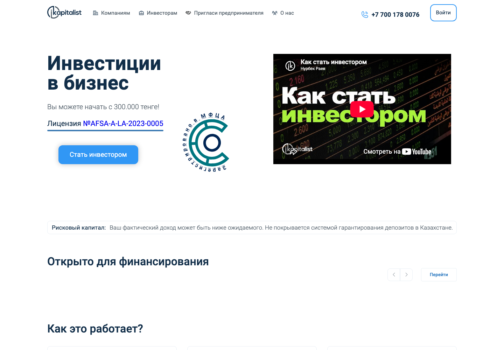
*Источник: https://ikapitalist.kz/investors.php , доступ 07.10.2026*

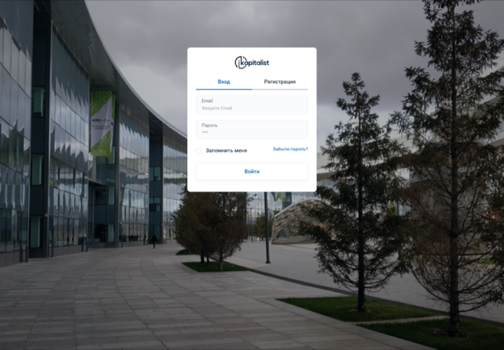
*Источник: https://platform.ikapitalist.kz/application/view/3231 (редирект на вход), доступ 07.10.2026*

#### FarmTogether

- **Кому:** только аккредитованные и институциональные инвесторы [15].
- **Матрица продуктов:** для каждого продукта указаны условия доступа («Accreditation Required», «US Person Status May Be Required»), минимальная сумма, структура [13].
- **Витрина:** карточка предложения с целевыми метриками; полные детали (финансовая сводка, юридические документы, структура) открываются только после регистрации: «Please register or log in to access the full offering details» [14].
- **Документы:** по каждому предложению профиль риска и доходности, структура комиссий и владения, юридические документы [15].

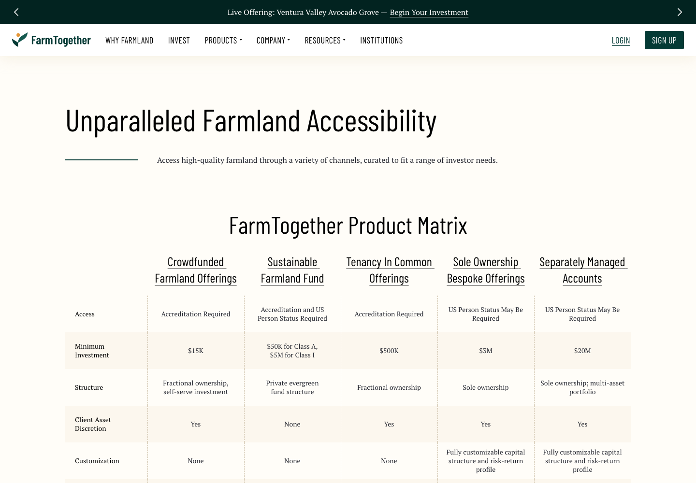
*Источник: https://farmtogether.com/how-it-works , доступ 07.10.2026*

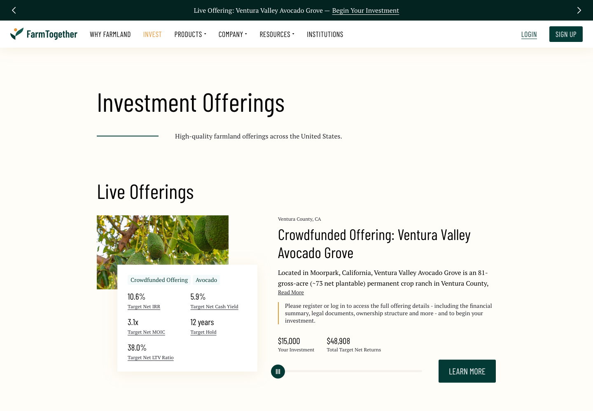
*Источник: https://farmtogether.com/investments , доступ 07.10.2026*

#### AcreTrader

- **Двери:** в шапке «Invest», «For Farmers», «For Advisors»; на главной поле email и «Get Started» для инвестора [16].
- **Дверь фермера:** отдельная страница «Maximize your farming enterprise. Equity financing that puts you in control every step of the way» со сценариями Expand / Improve / Transition [17].
- **Страница предложения:** статус «Open», привлекаемый капитал, цена доли, минимальная сумма, «Download Investment Memorandum», вкладки Overview / Maps / Financials / Documents, кнопки «Invest Now» и «Contact our Team» [18].

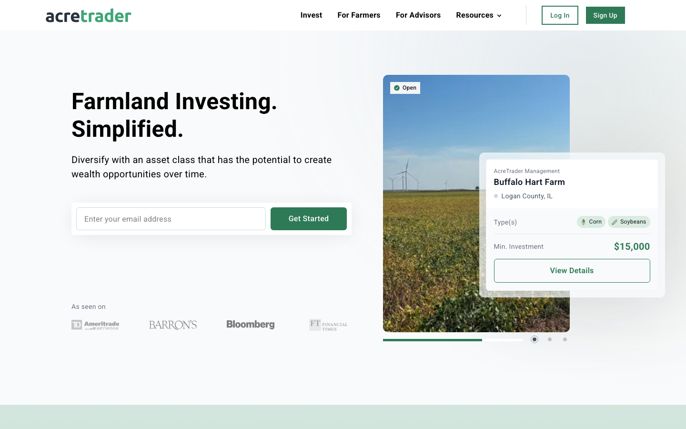
*Источник: https://acretrader.com/ , доступ 07.10.2026*

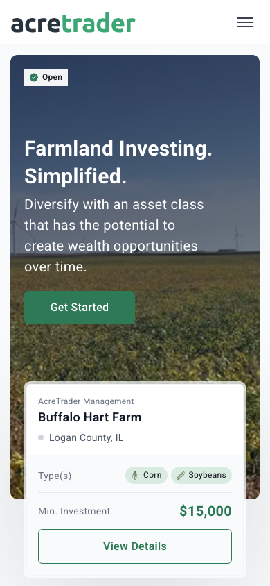
*Источник: https://acretrader.com/ (390 px), доступ 07.10.2026*

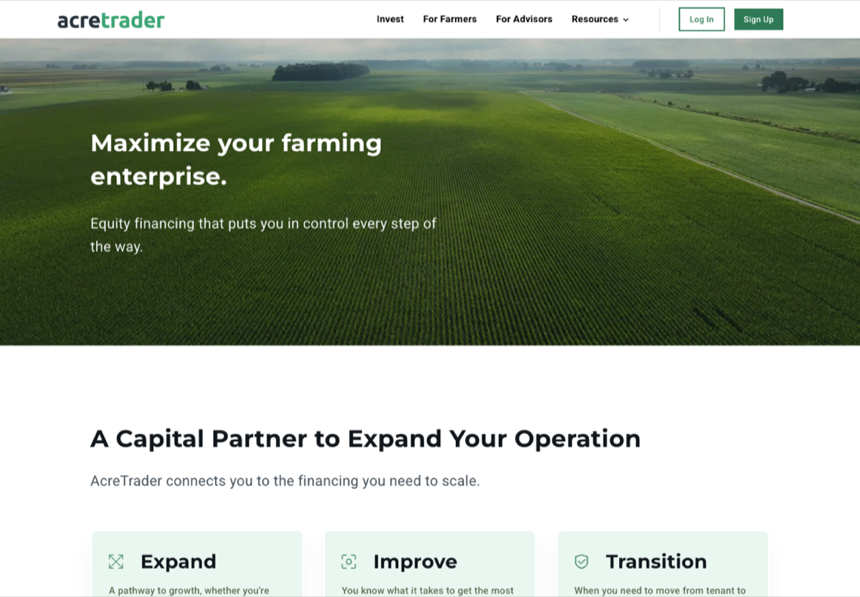
*Источник: https://acretrader.com/resources/farm-owners , доступ 07.10.2026*

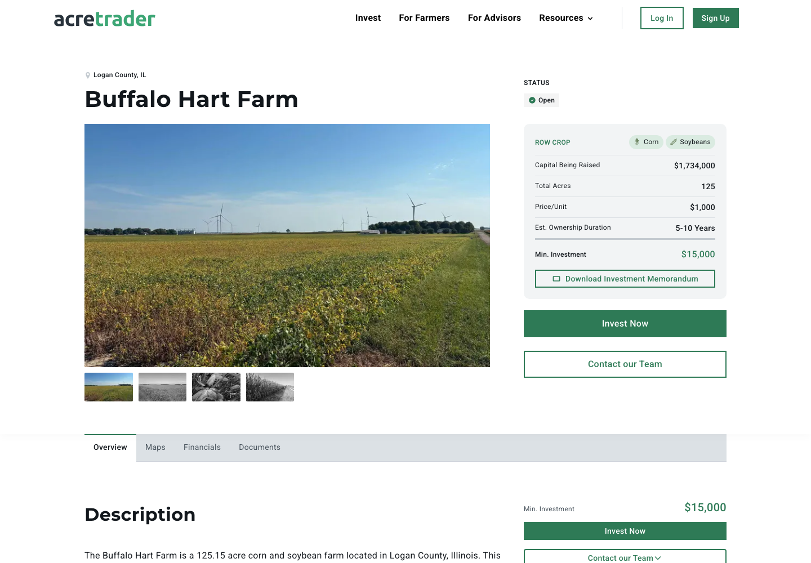
*Источник: https://acretrader.com/buffalo-hart-farm , доступ 07.10.2026*

#### Harvest Returns

- **Двери:** «Invest Now» и «Ag Business: Raise Capital» в меню; страница для производителей с одной кнопкой «Apply for Funding» [20]. Инвесторский портал вынесен на сторонний сервис (Agora), площадка работает с аккредитованными инвесторами [21].
- **Процесс для заёмщика из пяти шагов:** заявка → due diligence (запрос документов, бизнес-план, финпрогноз) → listing agreement → публикация → закрытие и получение денег. После закрытия заёмщик обновляет инвесторов, даёт финансовую отчётность и налоговые документы и делает выплаты [20].
- **Для F2F:** почти готовый шаблон для `/apply` и таймлайна заявки, включая обязательства после финансирования.

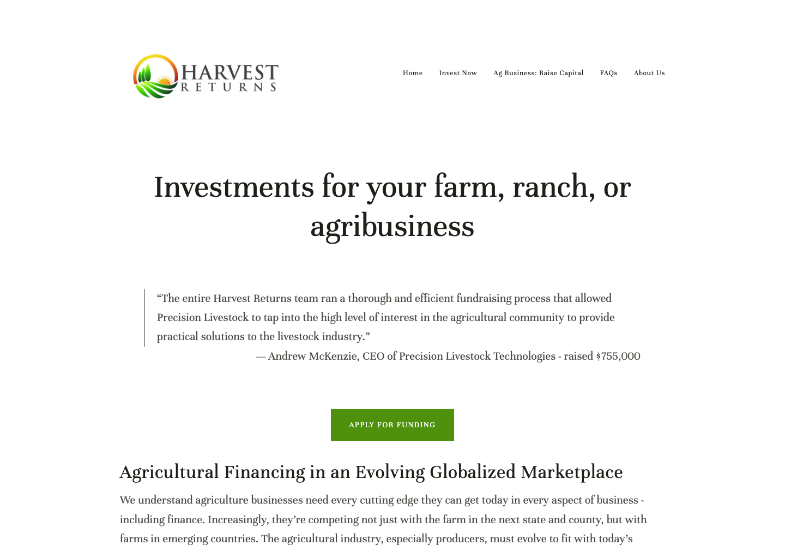
*Источник: https://www.harvestreturns.com/for-agproducers , доступ 07.10.2026*

#### Funding Circle (дополнительно)

Проверка соответствия без влияния на кредитный рейтинг, заявка онлайн «за семь минут», решение «в течение часа»; список документов заранее: выписки за 6 месяцев, отчётность, P&L и баланс [46]. **Для F2F:** заранее показанный чек-лист документов на `/apply`.

### 3.3 Справочные образцы для бэк-офиса

| Сервис | Что берём | Источник |
|---|---|---|
| Stripe | Роли как наборы прав (Administrator, IAM Admin, Super Admin, аналитики, Support); несколько ролей суммируются; роли на уровне организации и аккаунта; custom roles на основе встроенной роли | [38][39][41] |
| Stripe | Two-party approvals: действие прерывается, создаётся запрос, назначенный проверяющий одобряет или отклоняет; условия по сумме и по исполнителю | [40] |
| Linear | Owner / Admin / Team owner / Member / Guest; приглашения, приостановка участника; аудит-лог 90 дней, доступ только у владельцев, фильтры и выгрузка через API | [42][43] |
| Retool | Группы прав с уровнями Use / Edit / Own на папки приложений | [44] |
| Fireblocks | Политики авторизации транзакций, черновик политики перед публикацией, кворумы и разделение обязанностей | [45] |

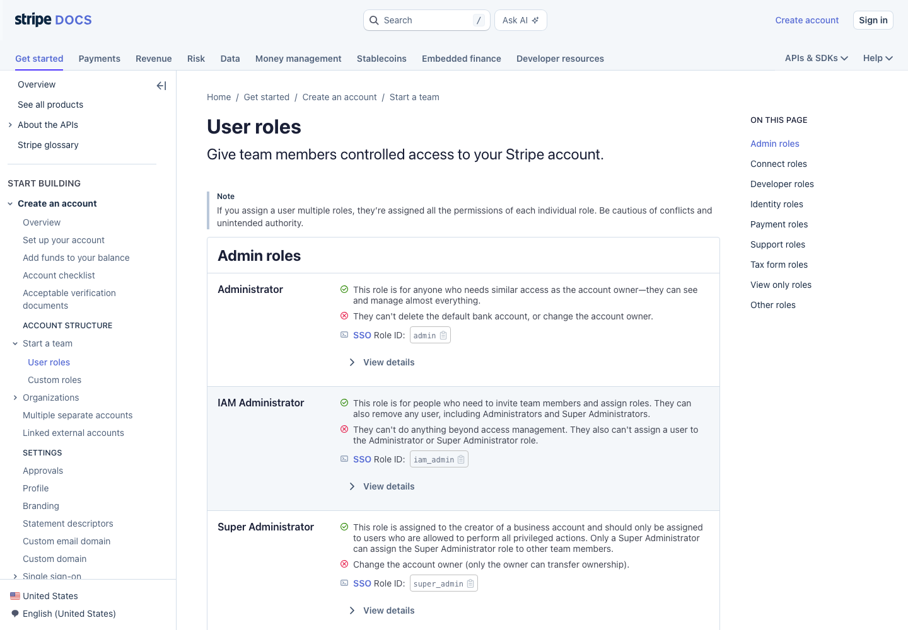
*Источник: https://docs.stripe.com/get-started/account/teams/roles , доступ 07.10.2026*

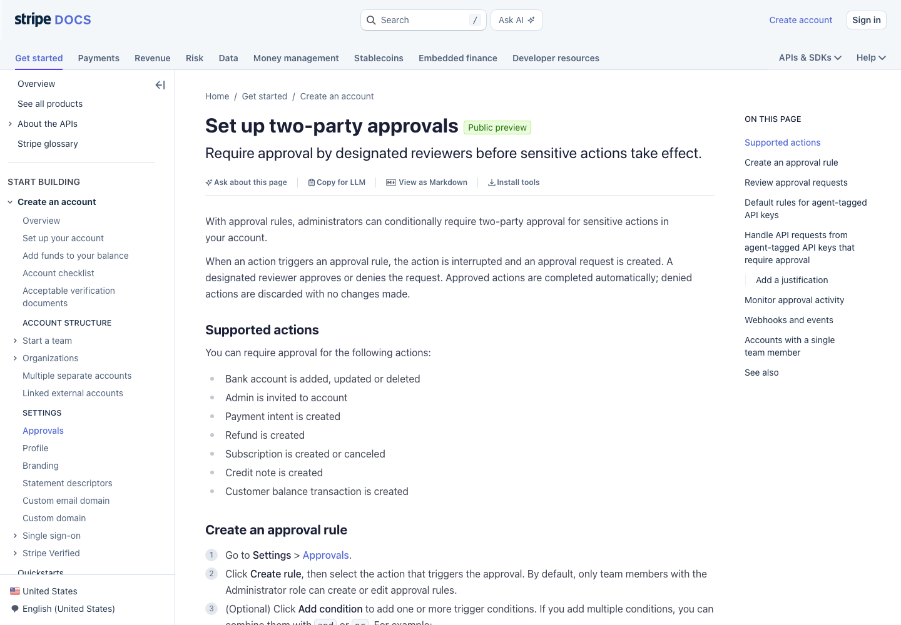
*Источник: https://docs.stripe.com/account/approvals , доступ 07.10.2026*

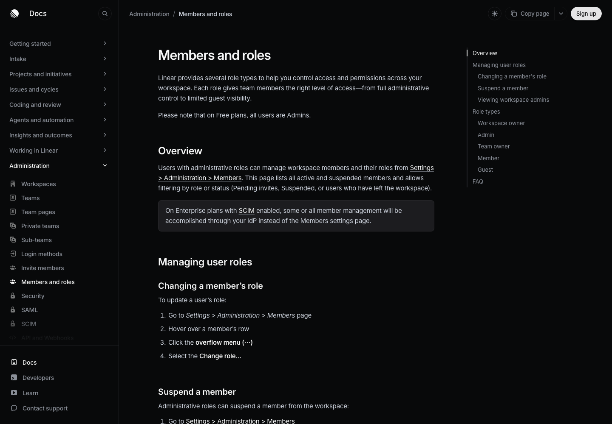
*Источник: https://linear.app/docs/members-roles , доступ 07.10.2026*

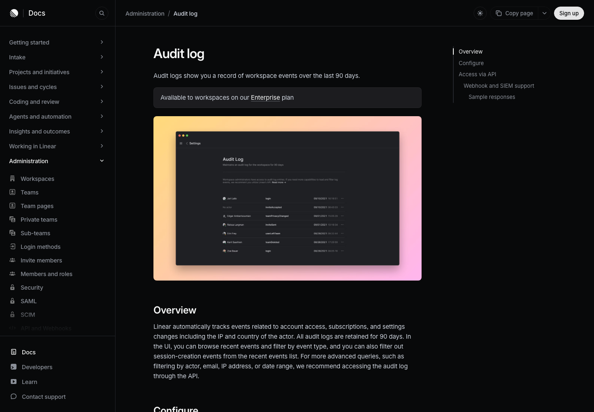
*Источник: https://linear.app/docs/audit-log , доступ 07.10.2026*

## 4. Каталог паттернов

Формат: что это; кто так делает; почему работает.

### (a) Лендинг и регистрация по аудиториям («раздельные двери»)

| Паттерн | Кто | Почему работает |
|---|---|---|
| Одна главная CTA для массовой аудитории (инвестор) | Mintos «Create account» [1], Go & Grow «Start investing» [5], AcreTrader «Get Started» [16] | Массовый сценарий без развилки; вторичные аудитории не конкурируют за внимание |
| Отдельный пункт меню для второй аудитории | AcreTrader «For Farmers» [16], Harvest Returns «Ag Business: Raise Capital» [20], Superstate «Issuers» [36] | Фермер сам находит свою дверь; роль известна до регистрации |
| Две равные кнопки, когда аудитории сопоставимы | iKapitalist [10] | Подходит, если поток заёмщиков сравним с потоком инвесторов. **Вывод:** у F2F инвесторов больше, поэтому ближе схема AcreTrader |
| Страница-объяснение для заёмщика перед заявкой | AcreTrader farm-owners [17], Harvest Returns [20], Funding Circle [46] | Отсекает нецелевые заявки: требования, процесс и документы видны заранее |
| Регистрация в один шаг по email/Google | Maple [31], AcreTrader (email в герое) [16] | Минимальное трение; квалификация позже |

### (b) Онбординг

| Паттерн | Кто | Почему работает |
|---|---|---|
| Этапы с явным статусом проверки | Superstate: Applications → Application Review → Entity Setup [37]; Ondo: KYC → реквизиты → подписание [35] | Пользователь видит, где он и кто сейчас действует |
| Ветвление KYC по типу инвестора | Goldfinch: физлицо/компания, страна, аккредитация → разные провайдеры [34] | Не заставляет всех проходить самый тяжёлый путь |
| Тест знаний и опыта, который открывает продукты | Mintos [2]; требования ECSPR с симуляцией убытка [9] | Регуляторное требование превращено в правило доступа, а не в формальность |
| Кошелёк после одобрения KYC | Superstate Allowlist [37], Ondo [35] | Технический шаг не спрашивают у того, кого ещё не допустили |
| Встроенный кошелёк на passkey, личность отдельно от кошелька | Tokeny [25] | Потеря кошелька не равна потере актива; новичку не нужен крипто-опыт |
| Email о результате проверки | Goldfinch [34] | Проверка асинхронна; пользователь не караулит экран |

### (c) Дашборд и портфель инвестора

| Паттерн | Кто | Почему работает |
|---|---|---|
| Три ключевых числа: стоимость, доход, свободные деньги | PeerBerry Overview: Profit status, Available for investment, Add funds [8]; Go & Grow Added/Gained [6] | Ответ на вопрос «сколько у меня и сколько я заработал» за секунду |
| Выписка с фильтрами как источник истины по доходу | Mintos Account Statement [4], Go & Grow statement [6] | Одно место для сверки и налогов |
| Объяснение, как считаются числа | Go & Grow «account values explained» [6] | Меньше обращений в поддержку из-за «неправильных» сумм |
| Метка допуска и минимальная сумма на карточке пула | Centrifuge [30], FarmTogether [13] | Инвестор не тратит время на недоступное |

### (d) Поток заёмщика / эмитента

| Паттерн | Кто | Почему работает |
|---|---|---|
| Нумерованные стадии заявки, включая обязательства после финансирования | Harvest Returns, 5 шагов [20] | Заёмщик заранее знает про отчётность и выплаты |
| Чек-лист документов до начала | Funding Circle [46] | Меньше возвратов на доработку |
| Страница сделки с вкладками и документами | AcreTrader: Overview / Maps / Financials / Documents [18]; Goldfinch: Repayment / Risk [33] | Одна запись, разные срезы; та же структура подходит для записи в консоли |
| Статус сделки на карточке | iKapitalist «На исполнении», процент сбора [10]; AcreTrader «Open» [18] | Жизненный цикл виден публично |

### (e) Бэк-офис

| Паттерн | Кто | Почему работает |
|---|---|---|
| Роль = именованный набор прав, проверка по праву | Tokeny матрица ролей [29], Stripe [38], Retool [44] | Новые роли собираются без изменения кода проверок |
| Узкие внешние агенты в той же консоли | Tokeny Token Agent, KYC-агенты [27][29] | Партнёр работает в общем процессе, но видит только своё |
| Отдельное право на квалификацию и отзыв | Tokeny Compliance Officer: Qualify / Revoke [26] | Решение по KYC отделено от операций |
| Права по доменам Read/Write | Tokeny Identities / Assets / Distribution [28] | Гранулярность без взрыва числа ролей |
| Двухсторонние подтверждения (maker-checker) | Stripe approvals [40], Fireblocks политики и кворумы [45] | Чувствительное действие не совершает один человек |
| Аудит-лог с фильтрами и выгрузкой | Linear [43], Stripe security history [41] | Ответ на вопрос регулятора «кто и когда» |
| Приглашения и приостановка участников | Linear [42], Stripe (до 10 приглашений на роль за раз) [41] | Доступ выдаётся и снимается без участия разработчиков |
| Custom roles поверх встроенных | Stripe [39] | Рост без переделки модели; на пилоте не нужно |
| Вход от лица пользователя | Securitize «Log in as an investor via API» [24] | Поддержка видит то же, что клиент. **Вывод:** для F2F только read-only и с записью в аудит |
| Очереди работы (Inbox) | Публичных скриншотов у бенчмарков нет; ближайший аналог Tokeny Candidate List как очередь на квалификацию [26] | **Вывод:** очередь по моим правам заменяет навигацию по пяти кабинетам |

### (f) Уведомления

- Email о результате проверки KYC [34]; у Tokeny email-уведомления настраиваются на уровне платформы (в справке разделы «Email Notifications» и собственный адрес отправителя) [29].
- **Вывод:** центр уведомлений внутри кабинета публично не показан ни у кого; для F2F достаточно email на смену статуса плюс блок «Следующее действие» на Overview.

### (g) Навигация и IA

- Публичная навигация называет аудитории, а не внутренние роли: «Invest / For Farmers / For Advisors» [16], «Issuers / Investors» [36]. Ни один бенчмарк не выводит в шапку названия служебных ролей вроде «Arranger».
- Документация и справка разведены по аудиториям: Maple (lenders / borrowers) [32], Securitize (investor / issuer help centers) [23][24], Tokeny (Servicing App / Investor App) [27].
- **Текущее состояние F2F:** шапка «Pools / Investor / Farmer / Arranger» показывает внутреннюю модель системы, что расходится со всеми изученными образцами.

### (h) Пустые состояния

- Tokeny: у Token Creator без токенов отдельный экран с кнопкой создания, при наличии токенов открывается дашборд [29].
- Goldfinch: при ошибке загрузки страница пула показывает «Shown data may be outdated» и скелетоны, а не пустоту [33].
- iKapitalist: блок «Открыто для финансирования» пуст, когда открытых сделок нет, ниже идут «Предыдущие сделки» [10]. **Вывод:** пустая витрина F2F должна показывать закрытые пулы и подписку на новые, а не пустой блок.

### (i) Сигналы доверия и раскрытия

| Паттерн | Кто |
|---|---|
| Номер лицензии со ссылкой на публичный реестр рядом с CTA | iKapitalist (AFSA) [10] |
| Полоса фактов под героем: пользователи, объём, лицензия | Mintos [1], FarmTogether (AUM, сделки, акры) [13] |
| Постоянный риск-баннер на странице инвестора | iKapitalist [11] |
| Отдельная страница риск-заявления | Go & Grow [7] |
| Подвал: юрлицо, регулятор, схема компенсации, риск-предупреждение | Mintos [1] |
| Оговорка под калькулятором дохода | Go & Grow [5] |
| Скоринг риска с публичной методикой | Mintos Risk Score [3] |
| KIIS по каждому предложению, 4 дня на отказ | ECSPR [9] |
| Меморандум для скачивания на странице сделки | AcreTrader [18] |
| Баннер допуска и предупреждение о дефолте | Goldfinch [33] |

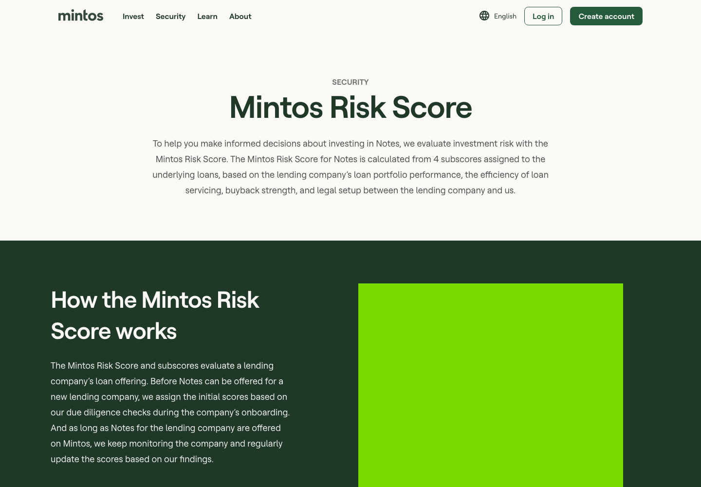
*Источник: https://www.mintos.com/en/security/mintos-risk-score/ , доступ 07.10.2026*

## 5. Что заимствовать и чего избегать

### Топ-10 паттернов для F2F

| # | Паттерн | У кого | Применение в F2F |
|---|---|---|---|
| 1 | Двери до регистрации: одна инвесторская CTA и отдельный пункт «Get financing» | AcreTrader [16], Harvest Returns [20], Superstate [36] | Шапка: Pools, Get financing, Sign in, CTA «Open an account»; выбор роли после входа убрать |
| 2 | Страница-объяснение для заёмщика с требованиями, шагами и чек-листом | AcreTrader [17], Harvest Returns [20], Funding Circle [46] | `/apply`: что финансируем, требования (страхование, акт на землю, отчётность), шаги, чек-лист |
| 3 | Этапы онбординга со статусом проверки | Superstate [37], Ondo [35] | `/invest/onboarding`: категория → KYC → риск → кошелёк; экран «На проверке» |
| 4 | Тест категории/знаний открывает продукты и лимиты | Mintos [2], ECSPR [9] | Категория (retail / professional) задаёт лимиты; retail видит лимиты освобождённого предложения |
| 5 | Кошелёк после одобрения KYC, встроенный кошелёк по умолчанию | Superstate [37], Ondo [35], Tokeny [25] | Privy embedded по умолчанию, Phantom опционально; шаг после одобрения или перед первой подпиской |
| 6 | Документ ключевой информации перед первой инвестицией в пул | ECSPR KIIS [9], AcreTrader меморандум [18] | KFD-гейт в `/invest/pools/[id]`, запись принятия |
| 7 | Страница сделки с вкладками и публичным статусом | AcreTrader [18], Goldfinch [33], iKapitalist [10] | `/pools/[id]`: Overview / Verification / Repayment / Documents / Risk; та же структура в консоли |
| 8 | Роль = набор прав; узкие внешние агенты в одной консоли | Tokeny [27][29], Stripe [38], Retool [44] | `/console` с ролями arranger, compliance, SCAS, elevator, lab, regulator; проверки по правам |
| 9 | Отдельное право на KYC-решение и отзыв + maker-checker | Tokeny Compliance Officer [26], Stripe approvals [40] | `kyc.decide`/`kyc.revoke` у compliance; позже второе подтверждение для KYC и выдачи средств |
| 10 | Аудит-лог и сигналы доверия (лицензия, риск-баннер) | Linear [43], iKapitalist [10][11], Mintos [1] | `/console/audit` с фильтрами и экспортом; риск-баннер и ссылка на реестр на `/` и `/pools/[id]` |

### Чего избегать

- Выбора роли после входа и названий внутренних ролей в публичной шапке (нет ни у одного бенчмарка).
- Отдельного кабинета на каждую служебную роль: у Tokeny все агенты работают в одном Servicing App [27].
- Требования кошелька на первом шаге: у RWA-платформ он идёт после допуска [35][37].
- Калькулятора доходности без оговорки о риске [5].
- Недоступных инвестору пулов без метки допуска [30][33].
- Ситуации, когда один оператор и проводит операции, и решает KYC, и подписывает аттестации партнёров: это противоречит разделению обязанностей [26][40][45].

## 6. Предлагаемая информационная архитектура F2F

### 6.1 Публичная часть

- `/` лендинг: герой для инвестора, одна CTA «Open an account», ниже блок для фермеров с переходом на `/apply`; полоса фактов (пилот, devnet, лицензия и реестр), риск-баннер по образцу iKapitalist [11].
- `/pools` витрина: карточки с купоном, сроком, суммой, прогрессом сбора, статусом и меткой допуска [30][10]; пустое состояние показывает закрытые пулы.
- `/pools/[id]`: вкладки Overview / Verification / Repayment / Documents / Risk [18][33]; кнопка «Invest» ведёт в `/invest/signup` или в инвесторскую версию страницы.
- Шапка: Pools, Get financing, Sign in, CTA «Open an account».

### 6.2 Дверь инвестора

- `/invest/signup` (Privy email) → `/invest/onboarding`: категория и appropriateness [2][9] → KYC [35] → риск-подтверждение [7] → кошелёк [25][37]. Статус «На проверке» с email по результату [34].
- `/invest` (верхнее меню): Overview (стоимость портфеля, баланс USDC, накопленный купон, следующая выплата [8][6]), Opportunities (`/invest/opportunities`, `/invest/pools/[id]` с KFD-гейтом и панелью инвестирования [9]), Portfolio (позиции, grain claims, график погашений), Activity (транзакции, CSV-выписка [4]), Account (статус верификации, категория, кошельки).

### 6.3 Дверь фермера / эмитента

- `/apply`: что финансируем, требования, шаги процесса, чек-лист документов, «Start application» [17][20][46].
- `/issuer`: Overview (следующее действие, таймлайн статуса [20]), Applications (`/issuer/applications`, `/new`, `/[id]` с чек-листом и таймлайном), Obligations (сумма к оплате, начисление Act/360, выбор способа расчёта, финансирование buyback), Company (профиль и KYC эмитента).

### 6.4 Вход и маршрутизация

- Одна страница `/sign-in` [12]. После входа: участник консоли → `/console`, эмитент → `/issuer`, инвестор → `/invest`. Email без учётной записи видит «Аккаунта пока нет» и две ссылки на двери, без выбора роли.
- Если у человека несколько учётных записей (например, сотрудник F2F, который ещё и тестовый инвестор), переключатель живёт в меню профиля, а не в развилке после входа. **Вывод** по аналогии с ролями на уровне организации и аккаунта у Stripe [41].

### 6.5 Консоль `/console`

Только по приглашению (`/invite/[token]`) [41][42]. Левое меню показывает только разделы, на которые есть право; пункты без права скрыты, а не заблокированы.

- **Inbox:** очереди по моим правам (заявки на ревью, KYC на решение, аттестации SCAS, приёмка элеватора, протоколы лаборатории, расчёты к проведению). Партнёр с одним правом попадает сразу в свою очередь.
- Applications, Issuers, Investors, Pools, Settlement, Verification, Delivery, Registry (регулятор, только чтение и экспорт), Audit, Team (участники, приглашения, матрица ролей), Settings (комиссии, казначейство).
- Записи (заявка, эмитент, инвестор, пул) открываются страницами с вкладками Overview / Documents / KYC / Verification / Activity, где Activity является аудитом по записи [18][33].

### 6.6 Матрица ролей и прав

Обозначения: ✓ есть право; R только чтение в узкой области; пусто нет права.

| Право | arranger | compliance | SCAS | elevator | lab | regulator |
|---|---|---|---|---|---|---|
| applications.view | ✓ | ✓ | | | | |
| applications.review | ✓ | | | | | |
| structuring.manage | ✓ | | | | | |
| issuers.view | ✓ | ✓ | | | | |
| kyc.decide | см. 6.7 | ✓ | | | | |
| kyc.revoke | см. 6.7 | ✓ | | | | |
| investors.view | ✓ | ✓ | | | | |
| investors.pii (новое) | | ✓ | | | | |
| limits.manage (новое) | | ✓ | | | | |
| pools.view | ✓ | ✓ | R | R | R | ✓ |
| pools.operate | ✓ | | | | | |
| settlement.operate | ✓ | | | | | |
| verification.view (новое) | ✓ | ✓ | R | | | ✓ |
| verification.attest | | | ✓ | | | |
| delivery.receipt | | | | ✓ | | |
| delivery.lab | | | | | ✓ | |
| registry.view | ✓ | ✓ | | | | ✓ |
| registry.export | ✓ | | | | | ✓ |
| audit.view | ✓ | ✓ | | | | ✓ |
| team.manage | ✓ | | | | | |
| settings.manage | ✓ | | | | | |

Пояснения:

- SCAS видит очередь верификации по полю (кадастр, координаты, культура) без названия компании, БИН и контактов: `verification.view` в узкой области, без `issuers.view`. Обоснование: Token Agent у Tokeny работает с дашбордом и действиями по токену без доступа к настройкам платформы [29]; права по доменам [28].
- Элеватор и лаборатория видят только свои записи в Delivery и пул в объёме, нужном для приёмки (R).
- Регулятор: Registry с БИН/ИИН и экспортом, аудит; без email, ответов KYC и `investors.pii`. Обоснование: роль только для чтения по образцу View only у Stripe [38]; доступ к аудиту по образцу Linear [43].
- `investors.pii`, `limits.manage` и `verification.view` добавлены как отдельные права: в базовой IA доступ к PII и лимитам retail описан у compliance, но не вынесен в список прав.
- Модель в целом опирается на: роль как набор прав и сумму прав при нескольких ролях [38]; узких агентов [27][29]; отдельное право квалификации и отзыва [26]; приглашения и приостановку [41][42]; аудит [43].

### 6.7 Расхождения с базовой IA

1. **Arranger и KYC-решения.** В базовой IA arranger «может всё». Предложение: на пилоте оставить, но как временную меру; цель: `kyc.decide` и `kyc.revoke` только у compliance. Обоснование: у Tokeny квалификация вынесена в отдельное право Compliance Officer [26]; принцип двухсторонних подтверждений и кворумов [40][45]. Если arranger всё же принимает решение, в аудит пишется отметка «override».
2. **Arranger и аттестации партнёров.** Предложение: не давать arranger `verification.attest`, `delivery.receipt`, `delivery.lab`. Ценность этих записей для инвестора в том, что их делает независимая сторона. Если нужна ручная правка (партнёр недоступен), это отдельное право `delivery.override` с обязательной причиной и аудитом. **Вывод автора**, прямого бенчмарка нет, опора на [26][40].
3. **Момент привязки кошелька.** В базовой IA кошелёк стоит последним шагом онбординга; предлагается сделать его обязательным только перед первой подпиской, а встроенный кошелёк Privy создавать автоматически. Обоснование: Superstate и Ondo запрашивают кошелёк после одобрения [37][35]; Tokeny скрывает кошелёк от новичков [25].
4. **Проверка соответствия до регистрации для фермера.** Предлагается на `/apply` короткая анкета соответствия (культура, площадь, регион, страхование) до создания аккаунта. Обоснование: Funding Circle проверяет соответствие до заявки [46]; Harvest Returns начинает с формы заявки [20].
5. **Уведомления.** В базовой IA нет раздела уведомлений. Предлагается email на каждую смену статуса (KYC, заявка, выплата) и настройки уведомлений в `/invest/account` и `/issuer/company` [34][29]; отдельный центр уведомлений на пилоте не нужен.
6. **Новые права** `investors.pii`, `limits.manage`, `verification.view` (см. 6.6).

### 6.8 Рекомендации на будущее

- **Maker-checker** для решений KYC и выдачи средств (disbursement) по образцу Stripe two-party approvals: действие создаёт запрос, второй участник с правом одобряет [40].
- **«View as» только для чтения:** участник консоли с отдельным правом видит кабинет инвестора или эмитента его глазами без возможности действовать; каждое использование пишется в аудит. Основание: Securitize «Log in as an investor via API» [24].
- **Custom roles** на основе встроенных, когда появится второй оператор или новый тип партнёра [39].
- **Аудит по записи** во вкладке Activity у каждой заявки, пула, инвестора, плюс общий журнал с фильтрами и экспортом [43].

## 7. Источники

Дата доступа ко всем: 07.10.2026.

1. Mintos, лендинг: https://www.mintos.com/en/
2. Mintos Help Center, Suitability and Appropriateness: https://help.mintos.com/hc/en-us/articles/6173936149649-What-is-the-Suitability-and-Appropriateness-assessment-and-how-does-i
3. Mintos Risk Score: https://www.mintos.com/en/security/mintos-risk-score/ ; https://help.mintos.com/hc/en-us/articles/360014829038-What-is-the-Mintos-Risk-Score
4. Mintos Help Center, доход и Account Statement: https://help.mintos.com/hc/en-us/articles/115002853069-How-can-I-see-income-earned-from-my-investments
5. Go & Grow, лендинг: https://goandgrow.eu/en/
6. Go & Grow, account values explained: https://goandgrow.eu/en/blog/go-grow-account-values-explained/
7. Go & Grow, General Risk Statement: https://goandgrow.eu/en/riskstatement/
8. PeerBerry, лендинг: https://peerberry.com/en
9. Eurocrowd, The Role of ECSPR in Investor Protection: https://eurocrowd.org/the-role-of-ecspr-in-investor-protection/
10. iKapitalist, лендинг: https://ikapitalist.kz/
11. iKapitalist, инвесторам: https://ikapitalist.kz/investors.php
12. iKapitalist, платформа (страница входа): https://platform.ikapitalist.kz/
13. FarmTogether, How it works: https://farmtogether.com/how-it-works
14. FarmTogether, Investments: https://farmtogether.com/investments
15. FarmTogether, FAQ: https://farmtogether.com/faq
16. AcreTrader, лендинг: https://acretrader.com/
17. AcreTrader, для владельцев ферм: https://acretrader.com/resources/farm-owners
18. AcreTrader, предложение Buffalo Hart Farm: https://acretrader.com/buffalo-hart-farm
19. AcreTrader, How it works: https://acretrader.com/how-it-works
20. Harvest Returns, для производителей: https://www.harvestreturns.com/for-agproducers
21. Harvest Returns, How our platform works: https://www.harvestreturns.com/how-our-platform-works
22. Securitize, лендинг: https://securitize.io/
23. Securitize Issuer Help Center, KYC Services: https://issuersupport.securitize.io/hc/en-us/articles/33022357578647-How-to-Use-Securitize-s-KYC-Service
24. Securitize Issuer Help Center, раздел Investors: https://issuersupport.securitize.io/hc/en-us/sections/33015984024215-Investors
25. Tokeny Docs, Onboard Investors: https://docs.tokeny.com/docs/onboard-investors
26. Tokeny Docs, Qualify Investors: https://docs.tokeny.com/docs/qualify-investors
27. Tokeny Docs, Servicing App: https://docs.tokeny.com/docs/servicing-app
28. Tokeny Docs, Permissions Management: https://docs.tokeny.com/docs/permissions-management
29. Tokeny Help Center, Guide: Permissions and roles of users: https://d9awyx7m9zmryg2.productfruits.help/en/article/guide-permissions-and-roles-of-users
30. Centrifuge App: https://app.centrifuge.io/
31. Maple App: https://app.maple.finance/
32. Maple Docs, syrupUSDC/USDT for Lenders: https://docs.maple.finance/syrupusdc-usdt-for-lenders/introduction
33. Goldfinch App, Senior Pool: https://app.goldfinch.finance/pools/senior
34. Goldfinch Docs, UID For Users: https://docs.goldfinch.finance/goldfinch/goldfinch-v1/unique-identity-uid/for-users
35. Ondo Docs, Onboarding & KYC: https://docs.ondo.finance/qualified-access-products/onboarding-and-kyc
36. Superstate, лендинг: https://superstate.com/
37. Superstate Docs, Getting started: https://docs.superstate.com/welcome-to-superstate/onboarding
38. Stripe Docs, User roles: https://docs.stripe.com/get-started/account/teams/roles
39. Stripe Docs, Custom roles: https://docs.stripe.com/get-started/account/teams/custom-roles
40. Stripe Docs, Set up two-party approvals: https://docs.stripe.com/account/approvals
41. Stripe Docs, Manage access to your organization: https://docs.stripe.com/get-started/account/orgs/team
42. Linear Docs, Members and roles: https://linear.app/docs/members-roles
43. Linear Docs, Audit log: https://linear.app/docs/audit-log
44. Retool Docs, Permission Groups and Access Rules: https://docs.retool.com/education/labs/governance/permissions
45. Fireblocks Developer Docs, Set Policies: https://developers.fireblocks.com/docs/set-transaction-authorization-policy
46. Funding Circle, How to get a small business loan: https://www.fundingcircle.com/uk/resources/business-finance/getting-a-small-business-loan-guide/
